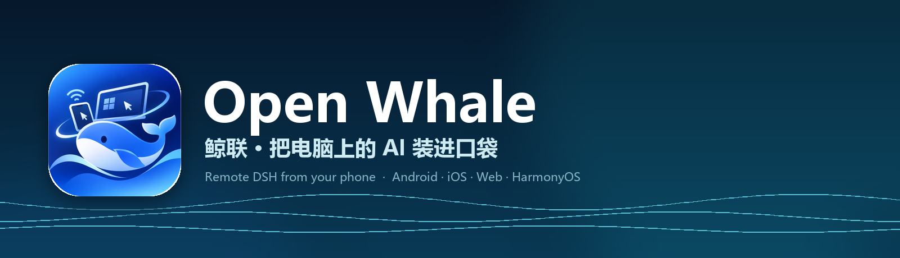
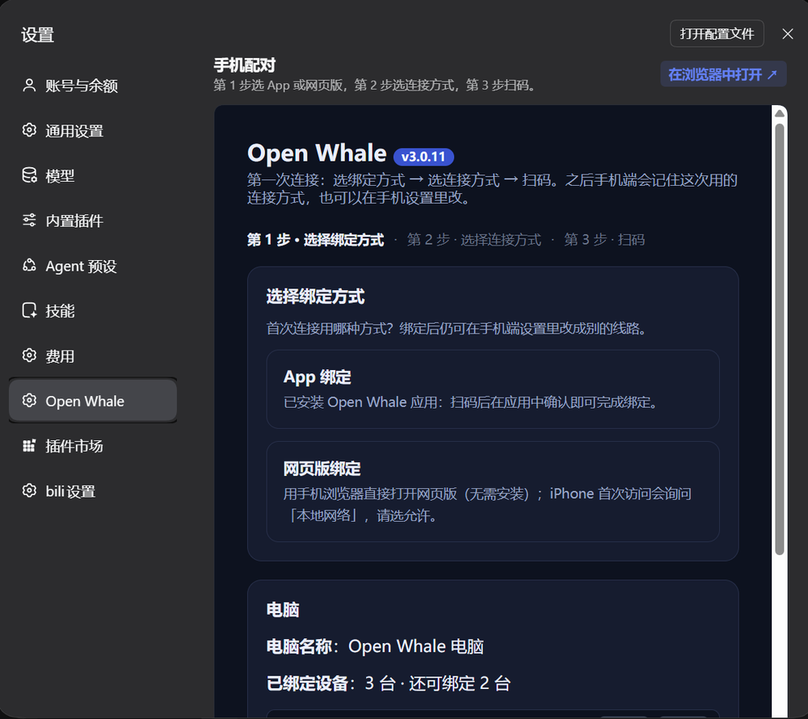
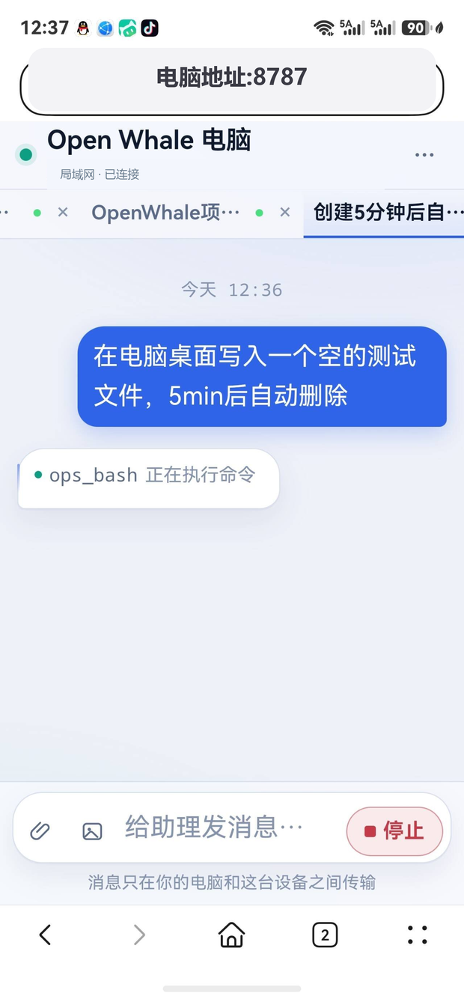
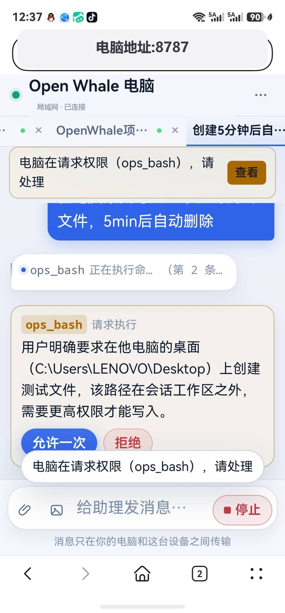
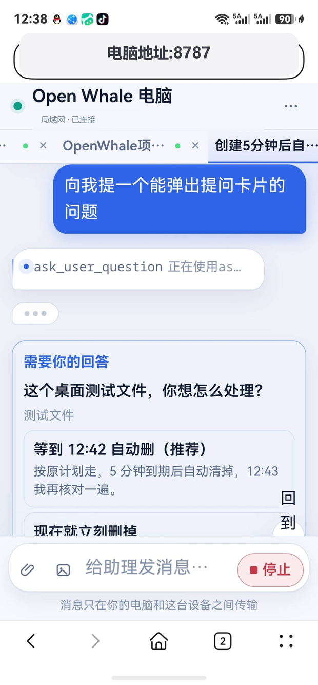
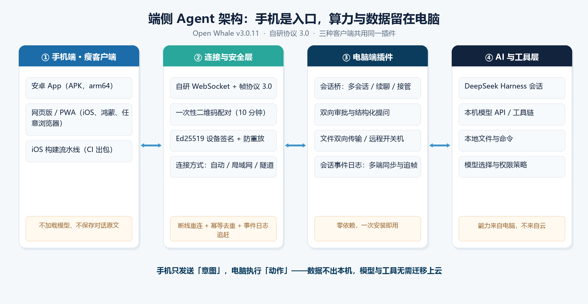

<div align="center">
  
</div>

<h3 align="center">Turn your phone into a remote control for the DSH on your desktop</h3>

<p align="center">
  Install one plugin on your computer, scan a QR code once, and then use
  <b>DeepSeek Harness</b> on your desktop from your phone as if you were chatting with an assistant:
  conversations, files, approvals, questions and multiple sessions — all in one chat window.
</p>

<p align="center">
  <a href="https://github.com/T1gerD/open-whale/releases/latest"></a>
  
  
  
  <a href="LICENSE"></a>
  <a href="https://github.com/T1gerD/open-whale/stargazers"></a>
</p>

<p align="center">
  <a href="#why-open-whale">Why</a> ·
  <a href="#screenshots">Screenshots</a> ·
  <a href="#features">Features</a> ·
  <a href="#quick-start">Quick start</a> ·
  <a href="#architecture">Architecture</a> ·
  <a href="#security">Security</a> ·
  <a href="#development">Development</a> ·
  <a href="README.md">中文</a>
</p>

---

## Why Open Whale

Cloud AI assistants **have a brain but no hands**: they cannot see the files, repositories or experiment data on your
computer, and they cannot touch your local tools. Remote-desktop apps **have hands but no brain**: they connect to your
machine, but you still have to drive the mouse yourself.

Open Whale fills the gap: **the phone sends intent, the computer executes actions.**

- **Data never leaves your machine** — models, files and commands stay on your own computer; phone and plugin talk
  directly, with no third-party server in between.
- **The power comes from your desktop** — it reuses the DSH session, model APIs and toolchain you already have.
  The phone neither loads models nor runs inference.
- **Scan and go** — one-time QR binding, then just open the app. Android APK and the iOS / HarmonyOS web app (PWA)
  share the same plugin.
- **Open source and auditable** — MIT licensed, the plugin has zero runtime dependencies; protocol, QR, WebSocket and
  upload layers are all implemented in-repo.

> In one line: **not another cloud chat app, but a pocket gateway to your personal computer's AI.**

---

## Screenshots

<div align="center">
  
  <br>
  <sub>Desktop: DSH Settings → Open Whale — binding, devices and “send to phone” live here</sub>
</div>

| Chat as command | Approve on phone | Structured questions |
| :---: | :---: | :---: |
|  |  |  |
| Send a message; DSH on the desktop starts working | Tool permission request — allow or deny from the phone | `ask_user_question` becomes a phone form |

---

## Features

### 💬 Conversations and tasks
- **Drive DSH remotely by chatting** — messages travel over WebSocket, streamed replies come back; each phone gets its
  own DSH session on the computer.
- **Personal-assistant tone** — injected as an agent-scoped prompt section for phone sessions only; desktop sessions are
  untouched (configurable or off).
- **Multi-session tabs** — a persistent tab bar at the top of the chat; switched-away sessions keep running in the
  background, with running dots and unread badges, restored after app restart.
- **Continue desktop sessions** — list all DSH sessions on the computer (title / time / running), pick one to continue
  or create a new one; the selection is visible on the desktop side too.

### 📎 Bidirectional files
- **Phone → desktop** — 512 KiB chunks with backpressure, progress and resume, up to **64 MiB** per attachment; files
  land in the session workspace, where the AI can read them.
- **Desktop → phone** — “Send to phone” on the pairing page, or assistant-produced files rendered as tappable cards.

### ✅ Approvals and questions
- **Dual-side approval** — when DSH asks to run a tool, desktop and phone both show it; answer on either side,
  **first answer wins**. If the phone answers first, the desktop dialog is dismissed via a cancel signal.
- **Answer questions on the phone** — `ask_user_question` and plan reviews become phone forms (single/multi choice,
  details, “other”); one batch submission; unanswered after 90s goes back to the desktop, late answers still accepted.
- **Higher-privilege requests** — out-of-workspace writes and similar requests state their reason explicitly.

### 🔗 Connectivity and devices
- **Four connection modes** — auto / LAN / Tailscale / public tunnel; auto tries “last success → Tailscale → LAN →
  tunnel”, racing the first two candidates.
- **One computer, up to 5 phones** — rename, unbind and see online state per device.
- **One phone, many computers** — shown as separate assistants on the phone, with editable local notes.
- **Remote shutdown / reboot** — with a 30-second cancellable grace window. Wake-on-LAN has physical limits; see
  [docs/remote-power.md](docs/remote-power.md).

### 🔐 Security
- The QR code carries a **one-time, 10-minute** binding secret; it is invalidated on success.
- After binding, authentication uses the phone's **Ed25519** key; the private key never leaves the phone's secure
  storage / browser.
- The QR code carries the computer's public key, so impersonating tunnels are detected; replayed handshakes are
  rejected.
- **State-changing HTTP endpoints** (unbind, rename, send-file, connection-mode) only accept loopback requests.
- The phone can only read files produced in the conversation (or sent by the computer), never arbitrary paths.

### 📱 Three clients, one plugin

| Client | Best for | Install |
|---|---|---|
| **Android app (APK)** | Daily use on Android | Download from [Releases](https://github.com/T1gerD/open-whale/releases/latest) |
| **Web app / PWA** | **iOS, HarmonyOS NEXT, any mobile browser** — no install | Scan the second QR with the system camera, or open `http://<computer>:8787/openwhale/app` and add to home screen |
| iOS app | Users who want their own build | `eas.json` + macOS pipeline, see [docs/iOS-HarmonyOS.md](docs/iOS-HarmonyOS.md) |

---

## Quick start

### 0. Download

Get the files from [Releases](https://github.com/T1gerD/open-whale/releases/latest) (each release ships `SHA256SUMS.txt`):

| File | Goes to | Notes |
|---|---|---|
| `dsh-openwhale-3.0.11.tgz` | Computer | Plugin package (includes web app and plugin page) |
| `dsh-openwhale.tgz` | Computer | Stable-name alias for scripts |
| `open-whale-3.0.11.apk` | Android phone | Android client (debug-signed, for personal use) |
| `open-whale.apk` | Android phone | Stable-name alias |

### 1. Desktop: install the plugin

Download `dsh-openwhale-3.0.11.tgz` from Releases, then:

```bash
dsh plugin --profile desktop add ./dsh-openwhale-3.0.11.tgz
```

> Replace `desktop` with your actual profile name, then **restart DSH**.
> The npm package is not published yet (see [docs/PUBLISHING.md](docs/PUBLISHING.md)); use the Release tarball.

For development you can install the source directory instead (restart DSH after edits):

```bash
cd open-whale
dsh plugin --profile desktop add ./packages/plugin
```

See [docs/install.md](docs/install.md) for details and troubleshooting.

### 2. Desktop: get the pairing QR

Open **DSH Settings → Plugins → Open Whale**, or visit `http://127.0.0.1:8787/openwhale`. There are two QR codes:

- **Phone app** — scan with the Android app;
- **Web app** — scan with the system camera; it opens the web app and binds automatically (iOS / HarmonyOS / any browser).

The QR is **valid for 10 minutes and single-use**.

### 3. Phone: bind

- **Android** — install the APK, open it, scan the first QR (gallery recognition and manual host:port are also supported).
- **Web app** — scan the second QR, or open `http://<computer>:8787/openwhale/app` and paste the pairing payload.

### 4. Pick a connection mode

| Mode | When to use |
|---|---|
| **Auto (default)** | Try “last success → Tailscale → LAN → tunnel”, racing the first two |
| LAN | Phone and computer on the same Wi-Fi |
| **Tailscale** | Both sides on the same tailnet; most reliable over the internet (stable IP, no tunnel) |
| Public tunnel | No Tailscale and no shared network; cloudflared quick tunnel (testing only) |

### 5. Done

Open the app or web page — no more scanning. If something goes wrong, check `$DSH_HOME/openwhale/openwhale.log`.

---

## Architecture

<div align="center">
  
</div>

1. **Phone** — a thin client: no models, no conversation storage; it sends intent and renders replies and file cards.
2. **Connection and security layer** — one-time pairing, Ed25519 signatures, replay protection, multi-path connectivity.
3. **Desktop plugin** — bridges phone messages to DSH sessions and pushes streams, approvals, questions and files back;
   manages devices, sessions and an event log.
4. **AI and tools layer** — your own DSH sessions, model APIs, local files and commands. The capability lives on the
   computer, not in the cloud.

Deliberate engineering choices:

- **Zero runtime dependencies** — the plugin is pure ESM that installs by copying; QR, WebSocket (RFC 6455), protocol,
  state and upload layers are self-implemented.
- **Self-contained, append-only protocol** — `packages/protocol` is the single source of truth; the plugin keeps a
  generated copy guarded by tests. Protocol 3.0 negotiates capabilities with older clients.
- **Client-side idempotency** — the desktop deduplicates on `(deviceId, msgId)`, solving offline retries and duplicate
  deliveries.
- **Event-log sync** — a bounded per-session event log plus cursor lets late or reconnecting phones catch up; falls back
  to a snapshot when the window is gone.
- **Unknown frames are ignored** — desktop and phone can upgrade independently.

---

## Security

- **Binding** — one-time, 10-minute secret, invalidated on success.
- **Authentication** — Ed25519 signature from the phone; replayed handshakes rejected.
- **Identity** — the QR carries the computer's public key, so impersonating tunnels are detected.
- **Permissions** — state-changing HTTP endpoints are loopback-only; phones can only read conversation-produced files.
- **Data** — direct phone-to-computer connection; no project-operated relay or cloud storage.

See [docs/security.md](docs/security.md) for the threat model and known limitations.

---

## Development

pnpm workspace (Node ≥ 22); the plugin itself needs no dependencies to run:

```bash
git clone https://github.com/T1gerD/open-whale.git
cd open-whale

node scripts/run-tests.mjs          # 58 test files / 982 tests (v3.0.11 baseline)
node scripts/run-tests.mjs qr       # filter by filename
node scripts/run-tests.mjs --self-test
node scripts/check-docs.mjs
node packages/mobile/scripts/check-syntax.mjs
```

Build the plugin package:

```bash
node scripts/build-plugin-package.mjs             # → release/dsh-openwhale-3.0.11.tgz
node scripts/build-plugin-package.mjs --npm-dir   # → release/npm-package/
```

Real-install verification in an isolated DSH environment:

```bash
export DSH_HOME=<empty dir>
dsh plugin --profile e2e add <repo>/packages/plugin
dsh --profile e2e --no-open
# in another terminal
node scripts/verify-install.mjs http://127.0.0.1:3080
```

Tests focus on real behaviour: live sockets, real QR decoding, protocol framing, pairing payloads, idempotency caches,
session event logs, RFC 6455 handshakes/fragmentation, gateway, uploads, DSH bridge, power, tunnels, and the pure logic
layers of the mobile and web clients.

---

## Roadmap

- [x] v1.0 — QR binding, chat, file delivery
- [x] v2.0 — multi-device collaboration, connection modes with racing
- [x] v2.2 — web app / PWA (iOS, HarmonyOS), 64 MiB chunked uploads, idempotency and multi-device sync
- [x] v3.0 — phone approvals (first answer wins), `ask_user_question` on phone, multi-session tabs, event-log catch-up
- [ ] iOS device builds and TestFlight (requires an Apple developer account)
- [ ] HarmonyOS native shell (ArkTS `Web` wrapper; PWA today)
- [ ] Background keep-alive and a native wake-proxy module
- [ ] Self-hosted relay / one-command private deployment
- [ ] More English docs and examples

---

## Known limitations

<details>
<summary>Open for the honest boundaries</summary>

- **Wake-on-LAN is physically limited**: after shutdown nothing on the computer is running. Only three paths work:
  an always-on LAN device sending magic packets (the plugin ships a wake proxy), the phone broadcasting on the same LAN,
  or out-of-band means (smart plug + “power on after AC loss”). The target also needs Wake on Magic Packet enabled,
  Windows Fast Startup disabled, and a wired connection.
- **Quick tunnels are not for production**: no uptime guarantee, changing hostnames, unstable in some regions.
  Use Tailscale or your own tunnel for long-term use.
- **HarmonyOS native app**: RNOH does not support RN 0.86 / Expo SDK 57 yet, so the web app (PWA) is the delivered
  client; a native shell can wrap it with DevEco's ArkTS `Web` component.
- **iOS**: `app.json`, `eas.json` and a GitHub Actions simulator pipeline are included; device installs / TestFlight
  require an Apple developer account (Expo cannot build iOS locally on Windows).
- **Phone UI and native modules have not been regression-tested on physical devices**: the dev machine has no Android
  SDK/JDK; builds run on GitHub Actions. The pure logic layers are fully unit-tested.
- **Not implemented yet**: phone background keep-alive, native wake-proxy module (guidance only).
- **Auto-approve is off by default**: DSH's normal approval policy applies; turning it on skips per-call confirmations
  for phone sessions.

</details>

---

## Docs

| Document | Contents |
|---|---|
| [docs/install.md](docs/install.md) | Install, configuration, troubleshooting |
| [docs/security.md](docs/security.md) | Threat model and known limitations |
| [docs/mobile-build.md](docs/mobile-build.md) | Building the Android APK |
| [docs/iOS-HarmonyOS.md](docs/iOS-HarmonyOS.md) | iOS builds and HarmonyOS adaptation |
| [docs/remote-power.md](docs/remote-power.md) | The real limits of remote power |
| [docs/PUBLISHING.md](docs/PUBLISHING.md) | Packaging and npm publishing |
| [CHANGELOG.md](CHANGELOG.md) | Release notes |

---

## Contributing

Issues, docs, bug fixes, tests and client ports are all welcome.

- Before a PR, run `node scripts/run-tests.mjs`, `node scripts/check-docs.mjs` and
  `node packages/plugin/scripts/sync-protocol.mjs --check`.
- **Do not add runtime dependencies to the plugin** — zero dependencies is what makes “copy and install” possible.
- Change `packages/protocol` first, then regenerate the in-plugin copy; the protocol is append-only.
- See [CONTRIBUTING.md](CONTRIBUTING.md).

If this project helps you, **a ⭐ Star** is the best support.

---

## Acknowledgements

- [DeepSeek Harness](https://github.com/deepseek-ai/deepseek-harness) — this plugin would not exist without it.
- Everyone who tried it, filed issues and gave feedback.
- The open-source community: QR encoding, WebSocket and tunneling are implemented here, but many design ideas came from
  public projects and docs.

---

## License

[MIT](LICENSE) © 2026 Open Whale contributors

<div align="center">
  <sub>Open Whale — put your desktop AI in your pocket</sub>
</div>
