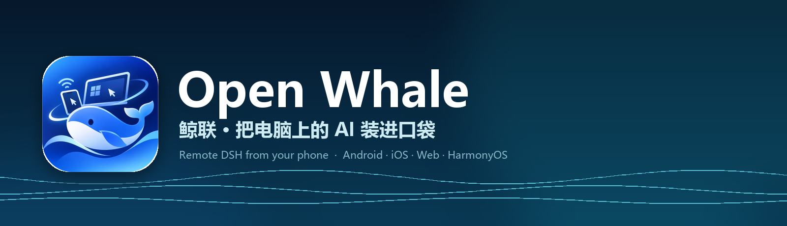
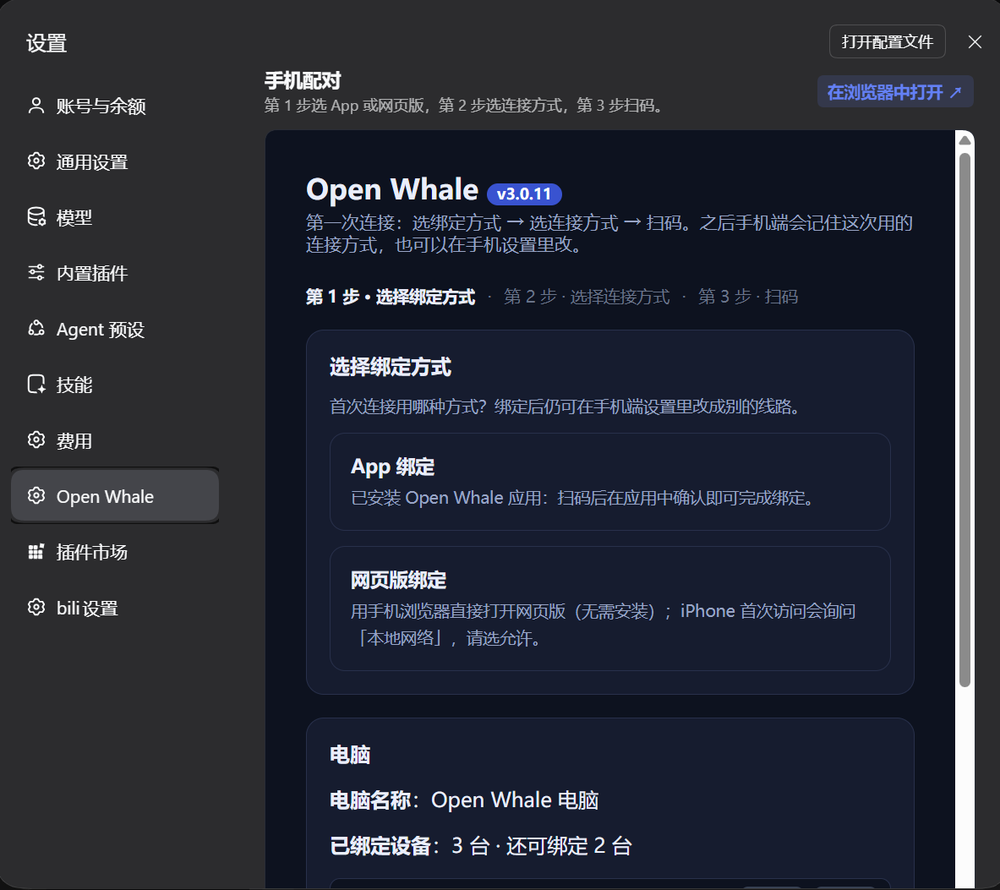
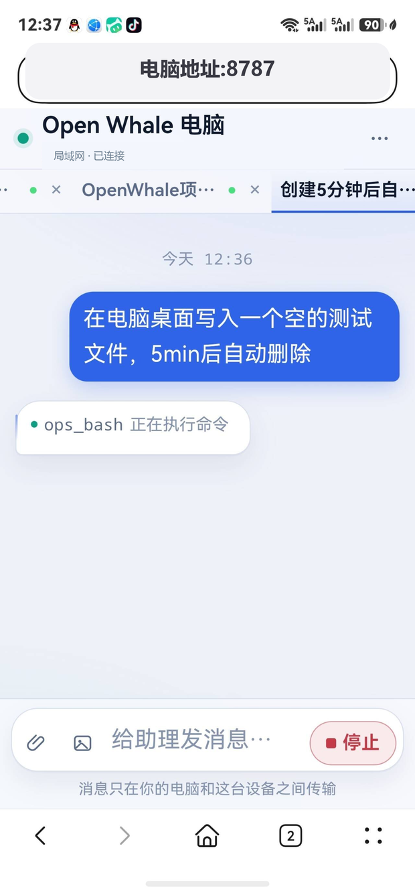
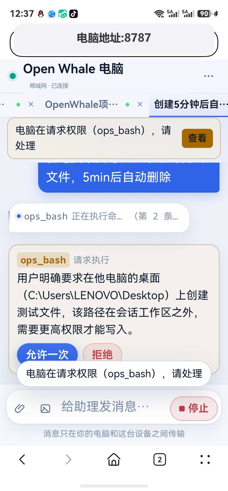
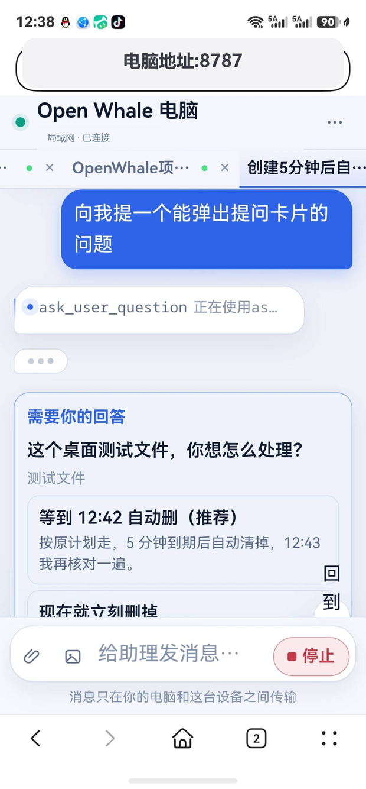
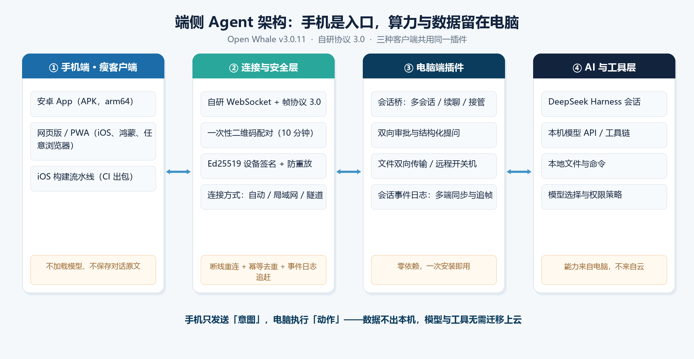

<div align="center">
  
</div>

<h3 align="center">把手机变成你这台电脑上 DSH 的随身入口</h3>

<p align="center">
  电脑上装一个插件，手机扫码一次，之后就能像跟助理聊天一样，远程使用电脑上的
  <b>DeepSeek Harness</b>：对话、文件、审批、提问、多会话，全部收进一个聊天窗口。
</p>

<p align="center">
  <a href="https://github.com/T1gerD/open-whale/releases/latest"></a>
  
  
  
  <a href="LICENSE"></a>
  <a href="https://github.com/T1gerD/open-whale/stargazers"></a>
</p>

<p align="center">
  <a href="#快速开始">快速开始</a> ·
  <a href="#功能">功能</a> ·
  <a href="#架构">架构</a> ·
  <a href="#安全">安全</a> ·
  <a href="#开发">开发</a> ·
  <a href="#文档">文档</a> ·
  <a href="README.en.md">English</a>
</p>

---

## 为什么是 Open Whale

云端 AI 助手**有脑子没手**：它看不到你电脑里的课程资料、代码仓库、实验数据，也碰不到本机的开发环境与工具。
远程桌面**有手没脑子**：能连上电脑，却只能靠你手动点鼠标，没有任何 AI 语义。

Open Whale 补的是中间这一步：**手机只发送「意图」，电脑执行「动作」**。

- **数据不出本机** —— 模型、文件、命令都在你自己的电脑上，插件与手机之间直连，不经过任何第三方服务器。
- **能力来自电脑** —— 复用的就是你已有的 DSH 会话、模型 API 与工具链，手机不加模型、不跑推理。
- **扫码即用** —— 一次性二维码绑定，之后打开就用；安卓 APK、iOS / 鸿蒙网页版（PWA）共用同一个插件。
- **开源、可审计** —— MIT 协议，插件零运行时依赖，协议、QR、WebSocket、上传层全部自研，代码可以直接读。

> 一句话：**不是又一个云端聊天 App，而是「个人电脑 AI 的随身入口」。**

---

## 界面

<div align="center">
  
  <br>
  <sub>电脑端：DSH 设置 → Open Whale，绑定方式、已绑定设备、发送到手机都在这里</sub>
</div>

| 聊天即指令 | 手机审批 | 结构化提问 |
| :---: | :---: | :---: |
|  |  |  |
| 发一条消息，电脑上的 DSH 开始执行 | 电脑请求权限，手机上「允许一次 / 拒绝」 | `ask_user_question` 转成手机表单，一次提交 |

> 截图来自 v3.0.11 的网页版（PWA）与 DSH 设置页；真实使用中界面文字以实际版本为准。

---

## 功能

### 💬 对话与任务
- **像聊天一样远程使用 DSH**：手机消息经 WebSocket 送达电脑，回复流式推回；每台手机在电脑上对应一个独立 DSH 会话。
- **口语化助理语气**：在该会话自己的作用域里注入「个人助理」system prompt，桌面会话不受影响；可在配置里改语气或关闭。
- **多会话标签条**：聊天页顶部常驻标签，点一下切换；切走的会话继续在后台跑，标签上显示运行点与未读数，重启后恢复。
- **直接续上电脑的会话**：手机读取电脑上的全部 DSH 会话（标题 / 时间 / 是否在跑），点一个就续聊，也可以新建；选中的会话在电脑端同步可见。

### 📎 文件双向
- **手机 → 电脑**：512 KiB 分块 + 背压 + 进度 + 断点重试，单附件上限 **64 MiB**，落盘在会话工作目录内，AI 能直接读。
- **电脑 → 手机**：配对页「发送到手机」→ 手机上出现一次性下载卡片；助手产出的文件也会以文件卡片出现在聊天里。

### ✅ 权限与提问
- **双端审批**：DSH 要审批工具调用时，电脑与手机同时展示；任意一端点「允许一次 / 拒绝」，**先答先算**。手机先答时，桌面弹窗会通过撤销信号自动关闭。
- **手机回答问题**：`ask_user_question` / 计划审阅会转到手机：选项（单选 / 多选）、详情、「其他」输入，一次整批提交；90 秒没人答交回电脑，超时后仍可补答。
- **更高权限的确认**：越权路径、工作区外写入等请求会明确标出原因，由你决定是否放行。

### 🔗 连接与设备
- **四种连接方式**：自动 / 局域网 / Tailscale / 公网隧道；自动模式按「上次成功 → Tailscale → 局域网 → 公网隧道」尝试，前两个候选并发竞速。
- **一台电脑绑多台手机**（上限 5 台）：配对页可单台改名、解绑、查看在线状态。
- **一台手机绑多台电脑**：在手机上显示为不同助理，备注可本地修改。
- **远程关机 / 重启**：带 30 秒可取消的宽限窗口；远程开机受物理条件限制，见 [docs/remote-power.md](docs/remote-power.md)。

### 🔐 安全
- 二维码是**一次性、10 分钟有效**的绑定密钥，绑定成功即失效。
- 绑定后用手机侧 **Ed25519 私钥**签名认证，私钥只在手机安全存储 / 浏览器本地，从不上传。
- 二维码里带电脑公钥，手机可验证握手签名；重放握手会被随机数防重放表拒绝。
- **会改变电脑状态的 HTTP 接口**（解绑、改名、发送文件、连接方式）只接受本机 loopback 请求，公网隧道打开配对页也无法远程改设置。
- 手机只能读取本次对话产出（或电脑主动发送）的文件，不能请求电脑上任意路径。

### 📱 三种客户端，同一个插件

| 客户端 | 适合 | 安装方式 |
|---|---|---|
| **安卓 App（APK）** | 安卓手机日常使用，体验最好 | 从 [Releases](https://github.com/T1gerD/open-whale/releases/latest) 下载安装 |
| **网页版 / PWA** | **iOS、鸿蒙 NEXT、任何手机浏览器**，零安装 | 系统相机扫插件页第二个二维码，或打开 `http://<电脑>:8787/openwhale/app`，可「添加到主屏幕」 |
| iOS App | 需要独立出包的用户 | `eas.json` + macOS 流水线，见 [docs/iOS-HarmonyOS.md](docs/iOS-HarmonyOS.md) |

---

## 快速开始

### 0. 下载

去 [Releases](https://github.com/T1gerD/open-whale/releases/latest) 下载（每个版本都附 `SHA256SUMS.txt` 可校验）：

| 文件 | 装到哪 | 说明 |
|---|---|---|
| `dsh-openwhale-3.0.11.tgz` | 电脑 | 插件包（含网页版与插件页） |
| `dsh-openwhale.tgz` | 电脑 | 固定名字的别名，脚本里用方便 |
| `open-whale-3.0.11.apk` | 安卓手机 | 安卓客户端（debug 签名，适合个人自用） |
| `open-whale.apk` | 安卓手机 | 固定名字的别名 |

### 1. 电脑端：装插件

从 Release 下载 `dsh-openwhale-3.0.11.tgz`，然后：

```bash
dsh plugin --profile desktop add ./dsh-openwhale-3.0.11.tgz
```

> 把 `desktop` 换成你实际使用的 profile 名。装完**重启 DSH**。
> npm 上的 `dsh-openwhale` 尚未发布（发布流程见 [docs/PUBLISHING.md](docs/PUBLISHING.md)），请用 Release 里的 tarball 安装。

开发时也可以直接装源码目录（改完只需重启 DSH）：

```bash
cd open-whale
dsh plugin --profile desktop add ./packages/plugin
```

详细步骤与排错见 [docs/install.md](docs/install.md)。

### 2. 电脑端：拿到绑定二维码

打开 **DSH 设置 → 插件 → Open Whale**（或浏览器访问 `http://127.0.0.1:8787/openwhale`），页面上有两个二维码：

- **手机 App 扫码**：给安卓应用扫；
- **网页版扫码**：用**系统相机**扫，会直接打开网页版并自动绑定（iOS / 鸿蒙 / 任意浏览器）。

二维码 **10 分钟有效、只能用一次**，绑定成功后立即失效。

### 3. 手机端：绑定

- **安卓**：安装 APK → 打开 → 扫第一个二维码（也支持相册识图 / 手动输入地址）。
- **网页版**：系统相机扫第二个二维码；或直接打开 `http://<电脑地址>:8787/openwhale/app`，在页面里粘贴配对内容。

### 4. 选择连接方式

配对页 / 手机设置里可以选：

| 方式 | 什么时候用 |
|---|---|
| **自动（默认）** | 依次尝试「上次成功 → Tailscale → 局域网 → 公网隧道」，前两个候选并发竞速 |
| 局域网 | 手机和电脑在同一个 Wi-Fi |
| **Tailscale** | 两边都装了 Tailscale 并登录同一 tailnet；外网访问最稳，固定 IP，不依赖公网隧道 |
| 公网隧道 | 没有 Tailscale、又不在同一网络时，用 cloudflared 临时隧道（仅建议测试用） |

### 5. 之后

直接打开应用 / 网页即可，不需要再扫码。出问题时先看插件日志：`$DSH_HOME/openwhale/openwhale.log`。

---

## 架构

<div align="center">
  
</div>

```
┌────────────────────┐   扫码绑定（一次性）   ┌─────────────────────┐
│  安卓 / 网页版手机   │ ◀─────────────────── │   电脑上的插件        │
│  多个助理 · 多会话   │                       │   dsh-openwhale     │
│  聊天 / 文件 / 审批  │   WebSocket 长连接     │                     │
└─────────┬──────────┘ ◀───────────────────▶ │  DSH 会话（可任选）  │
          │                                   └──────────┬──────────┘
          │   局域网 · Tailscale · 公网隧道               │
          └──────────────────────────────────────────────┘
```

**四层，各司其职：**

1. **手机端**：瘦客户端，不加载模型、不保存对话原文，只负责「意图、渲染、文件卡片」。
2. **连接与安全层**：一次性配对、Ed25519 签名、防重放、多路径连接（LAN / Tailscale / 隧道自动竞速）。
3. **电脑端插件**：把手机消息桥接到 DSH 会话，把流式输出、审批、提问、文件推回手机；管理多设备、多会话与事件日志。
4. **AI 与工具层**：你自己的 DSH 会话、模型 API、本机文件与命令 —— 能力来自电脑，不来自云。

**工程上的几个刻意选择：**

- **零运行时依赖**：插件是一次复制即可安装的纯 ESM 源码；QR 编码器、WebSocket（RFC 6455）、协议、状态层、上传层全部自研。
- **协议自包含、只增不改**：`packages/protocol` 是唯一权威源，插件内是生成副本并由测试防漂移；协议 3.0 与旧版客户端可混用（能力协商）。
- **幂等靠客户端 id**：电脑端按 `(deviceId, msgId)` 去重，解决离线重发与「同一条消息投递两次」。
- **多端同步靠事件日志**：每会话有界事件日志 + 游标，新加入 / 断线的手机能追上进度；窗口失效时退化成快照。
- **未知帧一律忽略**：电脑端与手机端可以独立升级。

---

## 安全模型

- **绑定**：一次性、10 分钟有效的密钥；绑定成功即失效，截图外发无长期价值。
- **认证**：手机侧 Ed25519 私钥签名（私钥只在手机安全存储 / 浏览器本地）；重放握手被拒。
- **身份**：二维码携带电脑公钥，手机据此验证 `hello/ack` 签名，冒名顶替的隧道会被识别。
- **权限**：会改变电脑状态的 HTTP 接口只接受 loopback；手机只能读取对话产出或电脑主动发送的文件。
- **数据**：手机与电脑直连，不经过本项目的服务器；不使用云端中转。

威胁分析与已知限制见 [docs/security.md](docs/security.md)。

---

## 开发

项目是 pnpm workspace（Node ≥ 22），插件本身不需要安装任何依赖即可运行：

```bash
git clone https://github.com/T1gerD/open-whale.git
cd open-whale

node scripts/run-tests.mjs          # 全部测试：58 个测试文件 / 982 项测试（v3.0.11 基线）
node scripts/run-tests.mjs qr       # 只跑文件名含 "qr" 的
node scripts/run-tests.mjs --self-test   # 自检测试运行器
node scripts/check-docs.mjs              # 版本 / 产物名 / 文档测试计数一致性
node packages/mobile/scripts/check-syntax.mjs
```

构建插件包：

```bash
node scripts/build-plugin-package.mjs             # → release/dsh-openwhale-3.0.11.tgz
node scripts/build-plugin-package.mjs --npm-dir   # → release/npm-package/（npm publish 用）
```

真实装机验证（隔离的 DSH 环境，不动你正在用的 `DSH_HOME`）：

```bash
export DSH_HOME=<某个空目录>
dsh plugin --profile e2e add <本仓库>/packages/plugin
dsh --profile e2e --no-open
# 另开一个终端
node scripts/verify-install.mjs http://127.0.0.1:3080
```

测试覆盖以「真实协议 / 真实 socket / 真实 QR 解码」为主：协议帧词汇、配对载荷、连接方式分类与排序、幂等缓存、会话事件日志、QR 编解码、RFC 6455 握手与分片、网关、上传、DSH 会话桥、电源、隧道、唤醒代理，以及手机端与网页版的纯逻辑层。

### 目录结构

```
open-whale/
├── packages/
│   ├── protocol/          协议契约（唯一权威源，含 44 项单测）
│   ├── plugin/            DSH 电脑端插件（纯 ESM、零运行时依赖）
│   ├── mobile/            Open Whale 手机应用（Expo / React Native / TS）
│   └── webchat/           网页版客户端（零构建、原生 ESM、PWA）
├── docs/                  安装、安全、出包、iOS / 鸿蒙、远程开关机
└── scripts/               测试、打包、装机验证、文档一致性检查
```

---

## 路线图

- [x] v1.0：扫码绑定 + 聊天 + 文件回传
- [x] v2.0：多设备协作会话、连接方式与自动竞速
- [x] v2.2：网页版 / PWA（iOS、鸿蒙零安装）、64 MiB 分块上传、幂等与多端同步
- [x] v3.0：手机审批（先答先算）、手机回答 `ask_user_question`、多会话标签、事件日志续聊
- [ ] iOS 真机包与 TestFlight（需要 Apple 开发者账号）
- [ ] 鸿蒙原生壳（ArkTS `Web` 组件封装；当前交付网页版 PWA）
- [ ] 手机后台保活、唤醒代理原生模块
- [ ] 自建中继 / 一键私有部署脚本
- [ ] 英文文档与更多示例

有想做的功能？欢迎开 [Issue](https://github.com/T1gerD/open-whale/issues) 或直接提 PR。

---

## 已知限制

<details>
<summary>点开查看（都是有意写清楚的边界）</summary>

- **远程开机受物理条件限制**：电脑关机后没有任何软件能唤醒它。可行路径只有三条：局域网内常开设备代发魔术包（插件内置唤醒代理）、手机与电脑同网时手机发广播、带外手段（智能插座 + 来电自启）；还需 BIOS 开启 Wake on Magic Packet、关闭 Windows 快速启动、网线连接。
- **快速隧道不适合长期使用**：无 uptime 保证、域名会变、部分地区不稳定。长期请用 Tailscale 或自建隧道。
- **鸿蒙原生应用**：RNOH 尚未支持 RN 0.86 / Expo SDK 57，当前交付网页版 PWA；原生壳可用 DevEco ArkTS `Web` 组件包一层。
- **iOS**：提供 `app.json`、`eas.json` 与 GitHub Actions 模拟器构建流水线；真机安装 / TestFlight 需要 Apple 开发者账号（Expo 不支持在 Windows 本地构建 iOS）。
- **手机端 UI 与原生模块尚未在真机回归**：开发环境没有 Android SDK / JDK，出包由 GitHub Actions 完成；纯逻辑层有完整单测。
- **尚未实现**：手机后台保活、唤醒代理原生模块（目前只做引导）。
- **自动批准默认关闭**：走 DSH 原有审批策略；开启后手机会话的工具调用会跳过逐条确认。

</details>

---

## 文档

| 文档 | 内容 |
|---|---|
| [docs/install.md](docs/install.md) | 安装、配置项、排错 |
| [docs/security.md](docs/security.md) | 安全模型、威胁分析与已知限制 |
| [docs/mobile-build.md](docs/mobile-build.md) | 安卓 APK 本地出包 |
| [docs/iOS-HarmonyOS.md](docs/iOS-HarmonyOS.md) | iOS 出包与鸿蒙适配 |
| [docs/remote-power.md](docs/remote-power.md) | 远程开关机的真实边界 |
| [docs/PUBLISHING.md](docs/PUBLISHING.md) | 插件包与 npm 发布流程 |
| [CHANGELOG.md](CHANGELOG.md) | 每个版本的变更记录 |

---

## 贡献

欢迎任何形式的参与：提 Issue、补文档、修 Bug、加测试、做客户端适配。

- 提交 PR 前请先跑 `node scripts/run-tests.mjs`、`node scripts/check-docs.mjs` 与 `node packages/plugin/scripts/sync-protocol.mjs --check`。
- **不要给插件引入运行时依赖** —— 零依赖是「一次复制即可安装」的前提。
- 改动协议请先改 `packages/protocol`，再同步生成副本；协议只增不改。
- 详见 [CONTRIBUTING.md](CONTRIBUTING.md)。

如果这个项目对你有用，**点一个 ⭐ Star** 就是最好的支持。

---

## 致谢

- [DeepSeek Harness](https://github.com/deepseek-ai/deepseek-harness) —— 没有它就没有这个插件。
- 所有提交 Issue、试用并反馈问题的同学与朋友。
- 开源社区：QR 编码、WebSocket、隧道等功能均自行实现，但设计思路受益于大量公开项目与文档。

---

## 许可证

[MIT](LICENSE) © 2026 Open Whale contributors

<div align="center">
  <sub>Open Whale（鲸联）· 把电脑上的 AI 装进口袋</sub>
</div>
